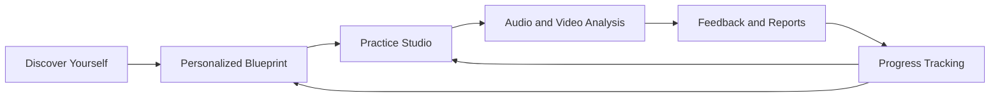
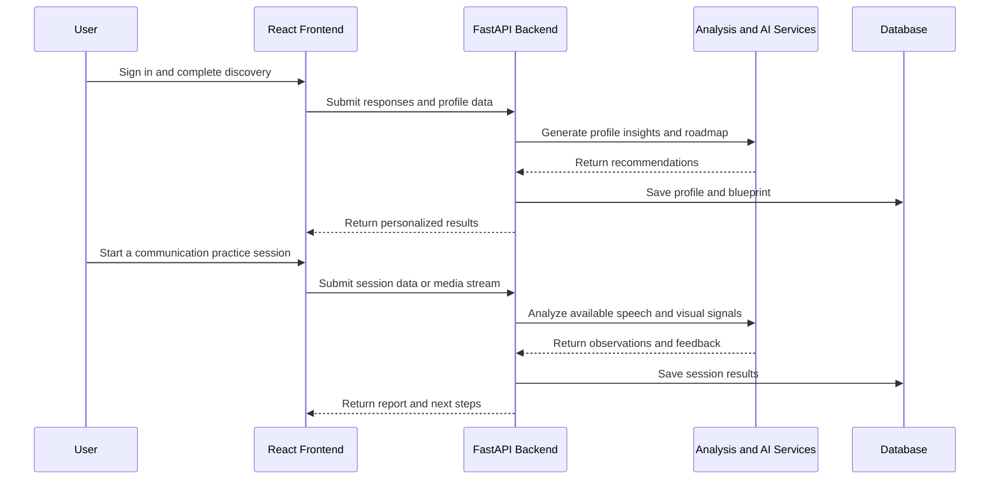
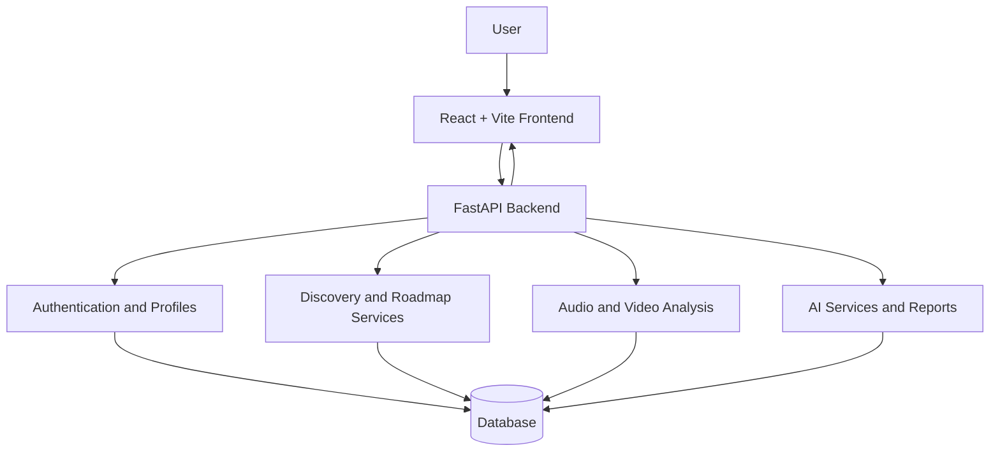

# Persona Prime

AI-assisted personal development and communication coaching for students and early-career professionals.

Persona Prime brings self-discovery, personalized development planning, communication practice, AI-assisted feedback, and progress tracking into one connected workflow.

<p align="center">
  <a href="https://persona-prime.vercel.app"><strong>Open Live App</strong></a>
  &nbsp;·&nbsp;
  <a href="https://github.com/logiclayer0/PERSONA_PRIME/issues">Report an Issue</a>
  &nbsp;·&nbsp;
  <a href="https://github.com/logiclayer0/PERSONA_PRIME/pulls">Contribute</a>
</p>

<p align="center">
  <a href="https://github.com/logiclayer0/PERSONA_PRIME/releases"></a>
  <a href="https://github.com/logiclayer0/PERSONA_PRIME/actions"></a>
  <a href="https://github.com/logiclayer0/PERSONA_PRIME/issues"></a>
  <a href="https://github.com/logiclayer0/PERSONA_PRIME/pulls"></a>
  <a href="https://github.com/logiclayer0/PERSONA_PRIME/blob/main/LICENSE"></a>
  <a href="https://github.com/logiclayer0/PERSONA_PRIME"></a>
</p>

> **Demo video:** [YouTube demo link — add when published](https://www.youtube.com/)

> **Important:** Persona Prime provides AI-assisted coaching and self-reflection. Its generated insights are not clinical assessments or definitive psychological diagnoses and should not replace professional advice.

---

## Table of Contents

- [Overview](#overview)
- [The Problem](#the-problem)
- [How Persona Prime Helps](#how-persona-prime-helps)
- [Core Features](#core-features)
- [User Journey](#user-journey)
- [System Architecture](#system-architecture)
- [Technology Stack](#technology-stack)
- [Repository Structure](#repository-structure)
- [Getting Started](#getting-started)
- [API Overview](#api-overview)
- [Security and Configuration](#security-and-configuration)
- [Development Priorities](#development-priorities)
- [Contributing](#contributing)
- [Limitations](#limitations)
- [License](#license)
- [Project Links](#project-links)

## Overview

Many students and early-career professionals receive generic advice but lack a structured way to understand their strengths, practice communication, and measure improvement. Persona Prime is designed to connect these activities in one place.

The platform follows a continuous growth cycle:

**Discover → Plan → Practice → Review → Improve**

It combines reflection, personalized roadmaps, guided communication practice, media analysis, feedback, and progress reports to help users turn self-awareness into practical next steps.

## The Problem

Personal development can be difficult to sustain when goals are vague, feedback is inconsistent, and improvement is hard to measure. Communication skills also require repeated practice—not just reading advice.

## How Persona Prime Helps

Persona Prime provides a structured workflow to help users:

- explore personal strengths, preferences, habits, and development areas
- build a personalized development blueprint and roadmap
- rehearse communication scenarios with scripts and guided practice
- review speech and visual delivery signals through audio/video analysis
- receive AI-assisted feedback and actionable recommendations
- track practice sessions and export reports for future reference

## Core Features

### 1. Discover Yourself

A guided self-discovery experience designed to help users reflect on their preferences, habits, strengths, and goals.

- guided discovery questions and self-reflection
- profile generation based on user responses
- resume-friendly profile information
- personalized development suggestions and roadmaps

### 2. Personal Development Blueprint

Turns discovery responses into a structured plan for growth.

- AI-assisted roadmap generation
- summaries of strengths, confidence areas, and growth opportunities
- actionable next steps based on user input
- blueprint export in PDF format

### 3. Communication Practice Studio

A guided environment for preparing and practicing communication.

- role- and category-based preparation
- script selection and rehearsal setup
- teleprompter-style support for practice
- speech and video analysis to review delivery quality
- support for practice sessions with an interactive coaching-oriented experience

### 4. Audio, Video, and Delivery Analysis

The analysis workflow combines multiple signals to provide more structured feedback on communication practice.

- speech/audio analysis, including Whisper-based transcription support
- visual analysis using MediaPipe, OpenCV, and NumPy
- posture, pose, gesture, and eye-contact-related cues where supported by the analysis pipeline
- grammar and speech-delivery feedback
- multimodal signal combination and scoring
- live/interim observations and session-level feedback, depending on the active workflow

Analysis results are intended as coaching signals. They may be affected by recording quality, lighting, camera placement, background noise, and model limitations.

### 5. Feedback and Reports

Helps users turn practice results into clear follow-up actions.

- structured feedback combining speaking and visual cues
- practical suggestions for communication improvement
- recommendations informed by session outcomes
- session summaries and PDF report export

### 6. Progress and Settings

Supports ongoing practice and a personalized experience.

- session history and progress monitoring
- profile and preference management
- theme settings
- authentication-protected access

### 7. Persona Experience

The interface is designed around confidence, self-understanding, and growth.

- interactive coaching-oriented UI
- avatar and 3D experience support
- guided user flows connecting discovery, planning, and practice

---

## User Journey

The intended workflow connects self-discovery to repeatable practice and review.



### Session flow



---

## System Architecture

Persona Prime uses a React-based frontend and a Python/FastAPI backend. The backend coordinates authentication, discovery, analysis, persistence, and AI-assisted recommendations.



The repository is organized into frontend and backend applications, with separate areas for pages, shared components, API routes, models, schemas, and services.

## Technology Stack

| Area | Technologies |
|---|---|
| Frontend | React 18, Vite, React Router |
| UI and Animation | CSS, Framer Motion |
| State Management and Requests | Zustand, Axios |
| 3D and Avatar Support | Three.js, React Three Fiber, Drei |
| Backend API | Python, FastAPI, Uvicorn |
| Data Validation | Pydantic, pydantic-settings |
| Persistence | SQLAlchemy, SQLite by default |
| Authentication | JWT via python-jose, Passlib/Bcrypt |
| Video and Vision | MediaPipe, OpenCV, NumPy |
| Speech Analysis | OpenAI Whisper, PyDub, FFmpeg |
| AI Roadmap Generation | Groq API |
| PDF Export | ReportLab |
| Deployment | Vercel frontend; Render-compatible backend |

## Repository Structure

```text
PERSONA_PRIME/
├── frontend/
│   └── src/
│       ├── pages/       # Landing, auth, dashboard, discovery, blueprint,
│       │                # studio, reports, progress, and settings
│       ├── components/  # Shared UI and avatar components
│       ├── services/    # API layer
│       ├── context/     # Providers and theme state
│       └── store/       # Client-side state
├── backend/
│   └── app/
│       ├── api/          # Auth, discovery, audio, video, analytics
│       ├── core/         # Analysis utilities
│       ├── models/       # SQLAlchemy models
│       ├── schemas/      # Request/response validation
│       ├── data/         # Discovery content
│       └── services/     # Roadmap and AI services
├── docker-compose.yml
├── LICENSE
├── README.md
└── package.json
```

*This is a high-level map; individual files and modules may vary as the project evolves.*

## Getting Started

### Prerequisites

- Git
- Node.js 18 or later
- Python 3.11
- FFmpeg for audio processing
- A Groq API key for roadmap generation

### 1. Clone the repository

```bash
git clone https://github.com/logiclayer0/PERSONA_PRIME.git
cd PERSONA_PRIME
```

### 2. Set up the backend

Create and activate a virtual environment from the repository root.

**Windows (PowerShell)**

```powershell
py -3.11 -m venv .venv
.\.venv\Scripts\Activate.ps1
pip install -r backend/requirements.txt
```

**macOS / Linux**

```bash
python3.11 -m venv .venv
source .venv/bin/activate
pip install -r backend/requirements.txt
```

Create a `backend/.env` file:

```dotenv
GROQ_API_KEY=your_groq_api_key
SECRET_KEY=replace_with_a_long_random_secret
ALGORITHM=HS256
ACCESS_TOKEN_EXPIRE_MINUTES=1440
DATABASE_URL=sqlite:///./persona_prime.db
FRONTEND_ORIGINS=http://localhost:5173,http://127.0.0.1:5173,https://persona-prime.vercel.app
```

Use your own credentials and a securely generated secret. Do not commit the `.env` file.

Start the API:

```bash
cd backend
uvicorn app.main:app --reload --host 127.0.0.1 --port 8000
```

When the backend is running, its interactive API documentation is available at:

- Swagger UI: [http://127.0.0.1:8000/docs](http://127.0.0.1:8000/docs)
- OpenAPI schema: [http://127.0.0.1:8000/openapi.json](http://127.0.0.1:8000/openapi.json)

### 3. Set up the frontend

Open a second terminal from the repository root:

```bash
cd frontend
npm install
npm run dev
```

The Vite development server is typically available at [http://localhost:5173](http://localhost:5173).

### 4. Run with Docker (optional)

If Docker Compose is configured for your environment:

```bash
docker compose up --build
```

---

## API Overview

The backend groups related functionality into route areas. Exact paths and request schemas should be checked in the running API documentation.

| Route area | Purpose |
|---|---|
| `/auth` | Registration, login, profile, and preferences |
| `/discovery` | Discovery questions, roadmap generation, and PDF export |
| `/audio` | Uploaded-audio analysis |
| `/video/analyze` | WebSocket-based video analysis |
| Analytics and script routes | Communication-practice support workflows |

For current request/response schemas, run the backend and open `/docs`.

## Security and Configuration

- Keep `.env` files, API keys, and secrets out of version control.
- Use a strong, unique production value for `SECRET_KEY`.
- Restrict `FRONTEND_ORIGINS` to trusted application domains.
- Use HTTPS for deployed environments.
- Validate required environment variables before starting the service.
- Treat AI-generated profiles and feedback as supportive guidance, not definitive judgments.

## Development Priorities

Potential areas for continued improvement include:

- adding automated tests for authentication, discovery, and analysis endpoints
- improving observability and resilience around AI and media-processing failures
- simplifying production deployment configuration
- continuing UI, accessibility, and usability improvements

These are development priorities, not a claim that the listed work is already complete.

## Contributing

Contributions and improvement suggestions are welcome.

1. Open an issue describing the bug, question, or proposed improvement.
2. Keep changes focused and avoid committing secrets or generated data.
3. Test the frontend or backend workflow affected by the change.
4. Include clear reproduction steps when reporting a bug.

Use the [Issues](https://github.com/logiclayer0/PERSONA_PRIME/issues) page to report problems or discuss enhancements, and the [Pull Requests](https://github.com/logiclayer0/PERSONA_PRIME/pulls) page to review or submit changes.

## Limitations

- Audio/video analysis quality depends on recording conditions, supported inputs, and model behavior.
- AI-generated feedback may be incomplete or inaccurate and should be reviewed with judgment.
- The local setup and default SQLite configuration are intended as a starting point; production deployments require environment-specific configuration and testing.
- Availability of individual analysis capabilities depends on the configured services and the active application workflow.

## License

Persona Prime is distributed under the MIT License. See [LICENSE](LICENSE) for details.

## Project Links

- **Live application:** https://persona-prime.vercel.app
- **Source code:** https://github.com/logiclayer0/PERSONA_PRIME
- **Issues:** https://github.com/logiclayer0/PERSONA_PRIME/issues
- **Pull requests:** https://github.com/logiclayer0/PERSONA_PRIME/pulls
- **Demo video:** Add the YouTube link here once the video is published.

---

<p align="center"><strong>Persona Prime — Discover your strengths. Practice with purpose. Grow with a plan.</strong></p>
