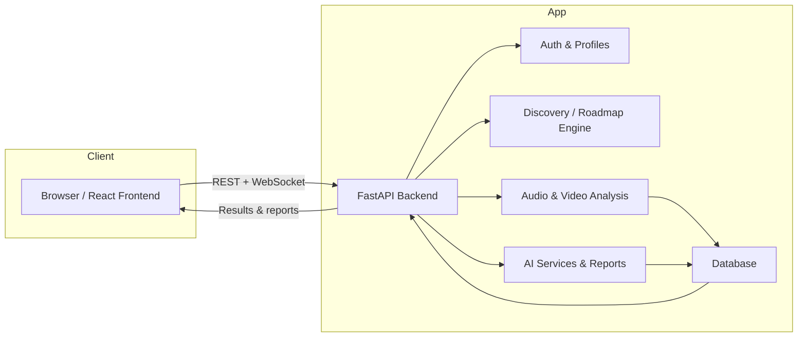
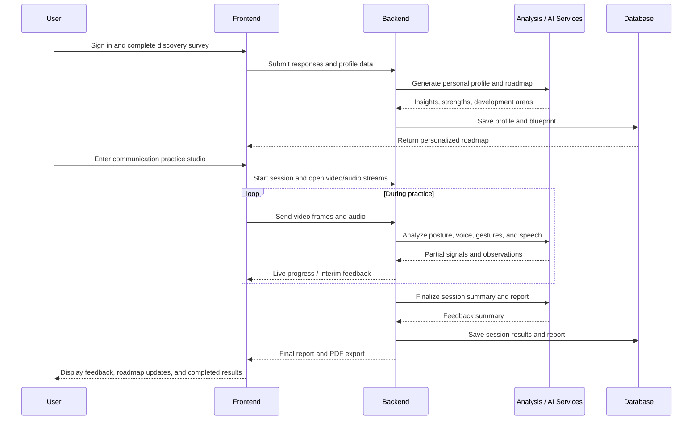

# Persona Prime

[](https://persona-prime.vercel.app)
[]()
[]()
[](LICENSE)

**AI-assisted personal development and communication coaching — helping users uncover strengths, refine communication skills, and turn reflection into an actionable growth plan.**

<p align="center">
  <a href="https://persona-prime.vercel.app"><strong>Live Application</strong></a>
  ·
  <a href="https://github.com/logiclayer0/PERSONA_PRIME/issues">Report an Issue</a>
  ·
  <a href="https://github.com/logiclayer0/PERSONA_PRIME/pulls">Contribute</a>
</p>

---

## Overview

Persona Prime is a personal development and communication coaching platform designed to help students and early-career professionals:

- understand their strengths, preferences, and development areas
- build a personalized roadmap based on reflection and self-assessment
- practice speaking and presentation skills with guided video-based feedback
- track progress and export actionable reports

The platform blends self-discovery, AI-assisted guidance, communication practice, and progress tracking into one experience.

---

## The Problem

Many learners and early-career professionals do not need only a list of goals — they need structured self-understanding, targeted feedback, and guided practice. Without intentional reflection and coaching, growth often becomes vague, inconsistent, or disconnected from real communication habits.

---

## The Solution

Persona Prime combines personal reflection, AI-generated guidance, communication rehearsal, and data-informed feedback in one workflow. It helps users convert self-awareness into a clear development path and supports regular practice with practical, measurable indicators.

> Generated insights are intended to support coaching and practice, not replace professional assessment or formal psychological evaluation.

---

## Feature Architecture



This architecture highlights the product's split between a modern React frontend and a Python/FastAPI backend that coordinates user journeys, analysis, and AI-assisted report generation.

---

## User Journey Flow



---

## Core Features

### 1. Discover Yourself
- Guided reflections on preferences, experiences, interests, and development goals
- Save-and-resume flow for profile generation
- Personalized profile built from user responses and development priorities

### 2. Personal Development Blueprint
- AI-assisted roadmap generation based on discovery insights
- Summary of strengths, confidence areas, development opportunities, and next steps
- View saved blueprint and export a PDF version

> Personality and confidence indicators are informational guidance derived from the current system logic and should not be treated as clinical or psychometric assessments.

### 3. Communication Practice Studio
- Guided role and category-based preparation workflow
- Script selection and practice setup
- Video analysis for posture, eye direction, face signals, and hand gestures
- Speech analysis for transcription, speaking pace, and filler-word detection

### 4. Feedback and Reports
- Combined analysis of speech and video signals into a structured report
- Observations focused on practical communication improvement
- Results depend on recording quality, environment, and processing success

### 5. Progress and Settings
- Session and progress tracking
- Profile, preferences, and theme management
- Authentication-protected app experiences and API access

### 6. Persona Experience
- Interactive avatar and coaching-oriented interface elements to deepen user engagement

---

## Technology Stack

| Area | Technologies |
|---|---|
| Frontend | React 18, Vite, React Router |
| UI & interaction | CSS, Framer Motion |
| State & requests | Zustand, Axios |
| 3D / avatar support | Three.js, React Three Fiber, Drei |
| Backend API | Python, FastAPI, Uvicorn |
| Data validation & config | Pydantic, pydantic-settings, python-dotenv |
| Persistence | SQLAlchemy; SQLite by default |
| Authentication | JWT via python-jose, Passlib/bcrypt |
| Video / vision | MediaPipe, OpenCV, NumPy |
| Speech analysis | OpenAI Whisper, PyDub, FFmpeg |
| AI roadmap generation | Groq API |
| PDF export | ReportLab |
| Deployment | Vercel frontend; Render-compatible FastAPI backend |

---

## Architecture Overview

The application is split into separate frontend and backend layers:

```text
Persona Prime
├── frontend/                 React + Vite application
│   └── src/
│       ├── pages/            landing, auth, dashboard, discovery,
│       │                     blueprint, studio, reports, progress, settings
│       ├── components/       shared UI and avatar components
│       ├── services/         API helper layer
│       ├── context/          theme and provider state
│       └── store/            client-side app state
│
├── backend/                  FastAPI service
│   └── app/
│       ├── api/              auth, discovery, audio, video, analytics,
│       │                     scripts and avatar routes
│       ├── core/              audio, pose, gesture and session analysis
│       ├── models/            SQLAlchemy models
│       ├── schemas/           request/response validation
│       ├── data/              discovery question data
│       └── services/          roadmap and AI-powered services
│
├── docker-compose.yml
├── LICENSE
├── README.md
└── .gitignore
```

---

## Getting Started

### Prerequisites

- Git
- Node.js 18 or later
- Python 3.11+
- FFmpeg for audio processing
- Groq API key for roadmap generation

### 1. Clone the repository

```bash
git clone https://github.com/logiclayer0/PERSONA_PRIME.git
cd PERSONA_PRIME
```

### 2. Configure the backend

Create and activate a virtual environment from the repository root.

#### Windows (PowerShell)

```powershell
py -3.11 -m venv .venv
.\.venv\Scripts\Activate.ps1
pip install -r backend/requirements.txt
```

#### macOS / Linux

```bash
python3.11 -m venv .venv
source .venv/bin/activate
pip install -r backend/requirements.txt
```

Create `backend/.env` with the following:

```dotenv
GROQ_API_KEY=your_groq_api_key
SECRET_KEY=replace_with_a_long_random_secret
ALGORITHM=HS256
ACCESS_TOKEN_EXPIRE_MINUTES=1440
DATABASE_URL=sqlite:///./persona_prime.db
FRONTEND_ORIGINS=http://localhost:5173,http://127.0.0.1:5173,https://persona-prime.vercel.app
```

Run the API from the backend directory:

```bash
cd backend
uvicorn app.main:app --reload --host 127.0.0.1 --port 8000
```

The API documentation is available at:

- Swagger UI: http://127.0.0.1:8000/docs
- OpenAPI schema: http://127.0.0.1:8000/openapi.json

### 3. Configure and run the frontend

From a second terminal:

```bash
cd frontend
npm install
npm run dev
```

Vite typically exposes the app at http://localhost:5173.

### 4. Run via Docker (optional)

```bash
docker compose up --build
```

---

## API Overview

The FastAPI service organizes its functionality into these route areas:

| Area | Purpose |
|---|---|
| `/auth` | registration, login, profile, preferences |
| `/discovery` | discovery questions, saved profile, roadmap, PDF export |
| `/audio` | uploaded-audio analysis |
| `/video/analyze` | WebSocket-based video analysis |
| analytics & script routes | communication-practice support workflows |

For full request and response schemas, use the running Swagger UI at `/docs`.

---

## Configuration and Security

- Keep `backend/.env`, credentials, and API keys out of version control
- Use strong production secrets for `SECRET_KEY`
- Restrict `FRONTEND_ORIGINS` to trusted frontend origins
- Use HTTPS in deployment
- Treat AI-generated analysis and roadmaps as supportive guidance, not definitive personal judgment

---

## Current Limitations

- Audio and video analysis may require significant processing time and memory, especially on first model load
- Quality of results depends on lighting, camera placement, microphone clarity, accent, and recording conditions
- AI roadmap generation requires valid Groq access and network connectivity
- Frontend and backend are deployed separately, so uptime depends on both services

---

## Development Priorities

- Add automated tests for auth, discovery, roadmap generation, and analysis endpoints
- Improve error handling and observability for AI/media-processing failures
- Validate production configuration and persistence setup
- Continue UX, accessibility, and end-to-end workflow testing

---

## Contributing

Contributions are welcome. Before submitting a change:

1. Explain the issue or improvement clearly
2. Keep changes focused and avoid committing secrets or generated data
3. Test the affected frontend or backend workflow
4. Include clear reproduction steps for bugs

Use the repository's Issues page to report bugs or propose enhancements.

---

## License

This project is distributed under the MIT License. See [LICENSE](LICENSE) for details.

---

## Links

- Live application: https://persona-prime.vercel.app
- Source code: https://github.com/logiclayer0/PERSONA_PRIME
- Issues: https://github.com/logiclayer0/PERSONA_PRIME/issues
- Pull requests: https://github.com/logiclayer0/PERSONA_PRIME/pulls

---

<p align="center"><strong>Persona Prime — Discover your strengths. Practise with purpose. Grow with a plan.</strong></p>
