<div align="center">


# KavachED

### Spot risk early. Act in time.
*A shield for every student.*

**AI-Powered Student Success and Early Intervention Platform**

**Python 3.10+ · Streamlit · SQLite · Groq AI · MIT License · Working Prototype**

[Live Demo](#quick-start) · [Features](#features) · [How It Works](#how-the-risk-score-works) · [Architecture](#architecture) · [Docs](#documentation)

</div>

---

## Table of Contents

1. [What is KavachED?](#what-is-kavached)
2. [The Problem](#the-problem)
3. [The Solution](#the-solution)
4. [Why KavachED is Different](#why-kavached-is-different)
5. [Features](#features)
6. [Architecture](#architecture)
7. [User Journey](#user-journey)
8. [How the Risk Score Works](#how-the-risk-score-works)
9. [Leave Calculator and What-If](#leave-calculator-and-what-if)
10. [How RAG Works](#how-rag-works)
11. [Database Design](#database-design)
12. [Tech Stack](#tech-stack)
13. [Quick Start](#quick-start)
14. [Demo Credentials](#demo-credentials)
15. [Configuration](#configuration)
16. [Deployment](#deployment)
17. [Project Structure](#project-structure)
18. [Testing](#testing)
19. [Security](#security)
20. [Limitations (Honest List)](#limitations-honest-list)
21. [Roadmap](#roadmap)
22. [FAQ](#faq)
23. [Team](#team)
24. [Acknowledgements](#acknowledgements)

---

## What is KavachED?

> **Kavach** (कवच) means *shield* or *armour* in Hindi. **ED** stands for *Education*.

Imagine a class of 30 students. One of them has been missing lectures for three weeks. Her marks are slipping. She has two assignments pending. Her teacher has no idea, because attendance is in one register, marks are in another sheet, and project notes are somewhere else.

She finds out she is in trouble only at exam time, when she is told she is below **75% attendance**. By then, it is too late to help.

**KavachED connects all of these records in one place.** It looks at attendance, assignments, class-test marks, projects and teacher remarks, and gives every student a clear **risk level (Low, Medium or High)** with the **reasons** and a **next step**.

In simple words: *KavachED tells teachers who needs help first, tells students where they stand, and tells both what to do next.*

---

## The Problem

Students struggle quietly, and scattered records notice it too late.

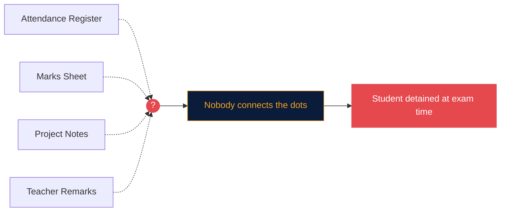

**A typical story (illustrative):**

| When | What happens | Result |
|---|---|---|
| Weeks 1-3 | Classes are missed. Attendance sits in a register. | Nobody connects it |
| Mid-term | Marks dip. Pending work sits in a separate sheet. | Nobody connects it |
| Exam time | Attendance is below the limit. | Student is detained, help comes too late |

**Scale of the context:** India has about **4.33 crore** students enrolled in higher education, with a Gross Enrolment Ratio of **28.4%** (ages 18-23). *Source: AISHE 2021-22, Ministry of Education, Government of India.* These figures show the scale of the system, so even small gaps in early support affect a very large number of students.

---

## The Solution

**One connected platform that turns scattered records into early warnings, each with a reason and a next step.**

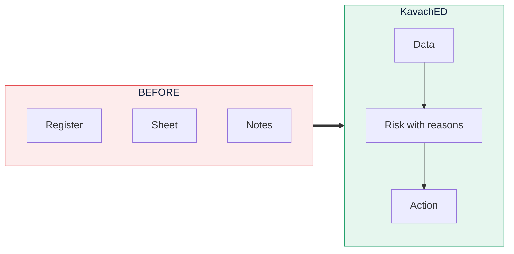

---

## Why KavachED is Different

> A sheet tells you who is absent. **KavachED tells you why it matters.**

| # | Edge | What it means |
|---|---|---|
| 1 | **Risk with reasons** | Every flag says why, for example "Attendance 62%, below the 75% limit", and what to do next |
| 2 | **Exact leave maths** | "How many classes can I still miss?" is answered with pure arithmetic, not AI guesses |
| 3 | **Coach on real numbers** | The study coach uses only your own records |
| 4 | **Answers with sources** | Ask your college documents; every reply cites the document and chunk |
| 5 | **Detection to action** | Flag, plan and track help in one place |
| 6 | **Private workspace per teacher** | A new account starts empty and never sees another college's data |
| 7 | **Never breaks** | If the AI service is down, a rule-based fallback answers |

---

## Features

### Teacher Features

| Page | What you can do |
|---|---|
| **Overview (Command Center)** | KPI cards with weekly change, risk donut, risk by section, 8-week attendance trend, attendance heatmap (subject x section), Top 5 students needing attention, smart alerts |
| **Students** | Search and filter by risk, section and subject; colored risk pills; top reason and weakest subject; "needs extra classes" groups; export filtered CSV; add-student dialog |
| **Student 360** | Full profile with risk badge and trend (Improving, Stable, Declining); radar chart; 8-week sparkline; subject table; remarks timeline; interventions; printable student report |
| **Interventions** | Kanban board: **Planned**, **In progress**, **Done**, with move buttons and counts |
| **Data Studio** | Add student, add or update subject record, add remark, **bulk CSV upload** (template, column validation, row-level errors, preview), export all data |
| **Knowledge Base** | Upload `.txt` or `.pdf` policy documents; see chunk count and preview; delete with confirmation |
| **Ask KavachED** | Ask questions and get cited answers from your documents |
| **Settings** | Profile, change password, theme, class code with regenerate, danger zone |

### Student Features

| Page | What you can do |
|---|---|
| **My Overview** | Risk badge in plain language, KPI cards, subject progress, attendance vs 75% line, assignment pie, 8-week trend, teacher remarks, per-subject leave calculator |
| **My Subjects** | Per-subject attendance, assignments, CT marks, "classes you can still miss" or "classes needed to recover" |
| **Study Coach** | Analyze strengths and weaknesses, improvement tips, weekly Mon-Sun study plan, in **English or Hinglish**, with download |
| **What-If and Goals** | Sliders: "attend next N classes" and "score X in next CT", with before/after gauges; goal tracker (default 80%) |
| **Ask KavachED** | Ask about college rules with cited answers |
| **Settings** | Profile, password, theme |

### Everyone Gets

- **KavachBot**: a side-panel assistant in the sidebar (AI online or rule-based mode)
- **Light and dark mode** that persists across pages
- **Animated 3D background** (pure CSS, respects reduced-motion)
- **Guided onboarding** and friendly empty states for new accounts
- **Email or Google sign-in** (Google is optional)

---

## Architecture

How a click travels from the screen to an answer:

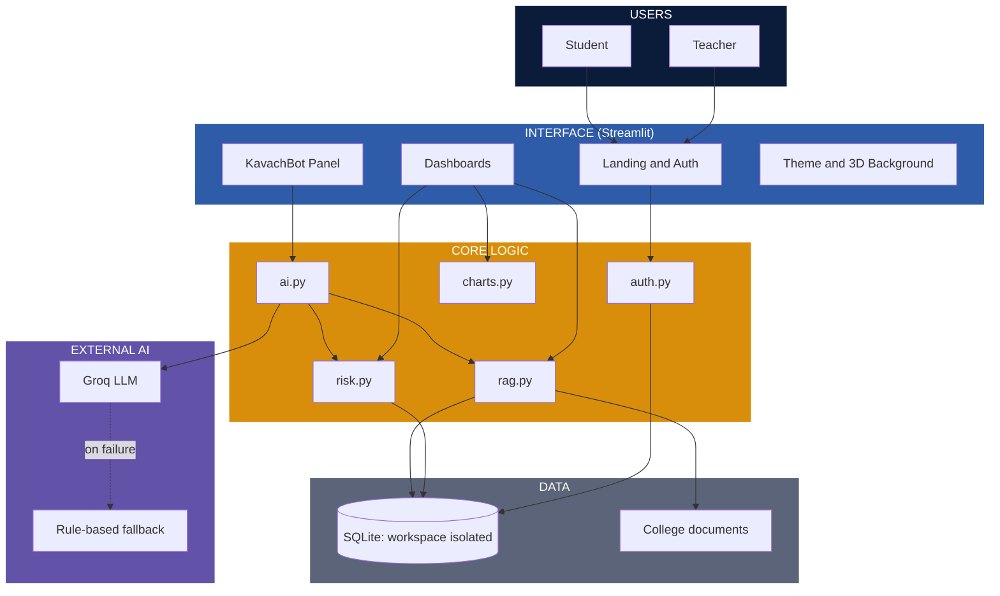

### Layers in plain language

| Layer | Job |
|---|---|
| **Users** | Teachers and students, each with their own view |
| **Interface** | Everything you see: login, dashboards, chat panel, themes |
| **Core logic** | The "brain": risk rules, leave maths, document search, study coach |
| **Data** | SQLite database (private workspace per teacher) and uploaded documents |
| **External AI** | Groq writes answers; simple rules take over if Groq is unavailable |

---

## User Journey

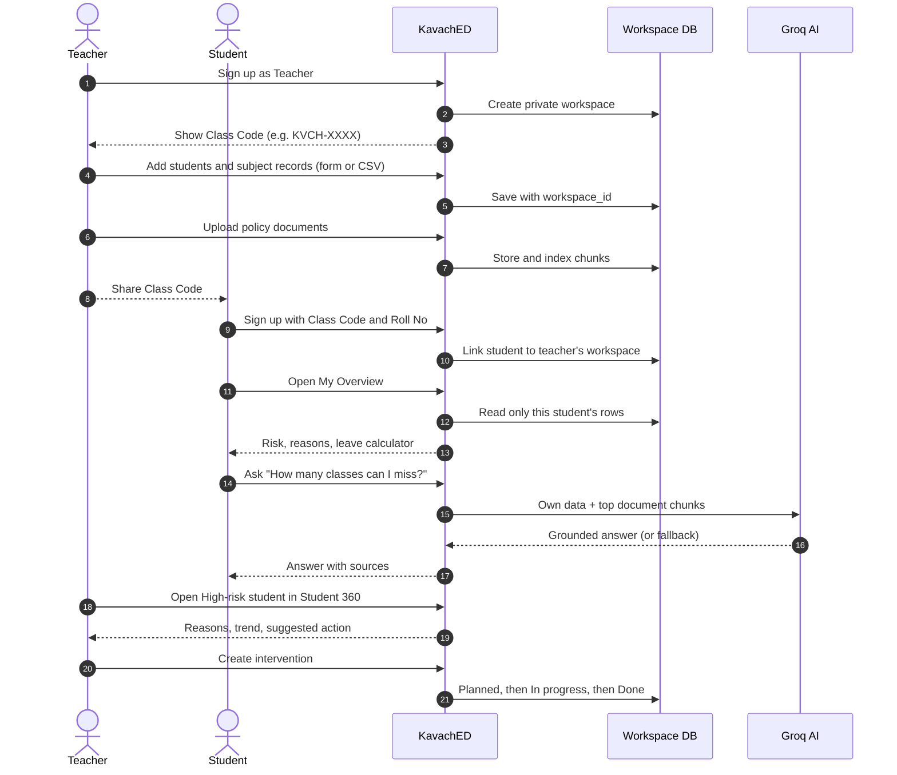

### Intervention lifecycle

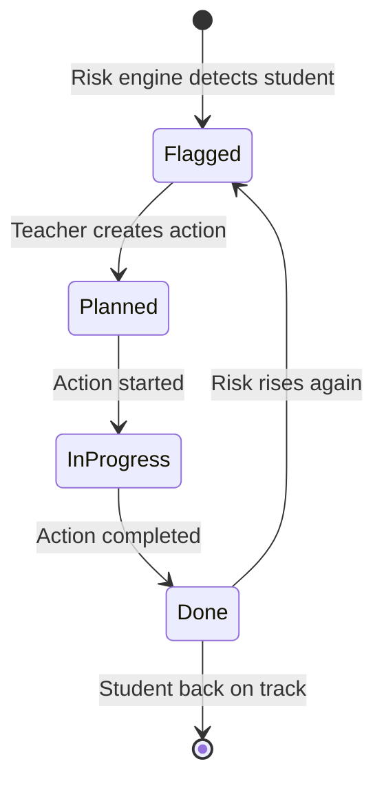

---

## How the Risk Score Works

The risk engine is **rule-based on purpose**. It uses **no machine learning**, so every flag is **fully explainable**. Teachers and students can see exactly why.

### The rules

| Factor | Rule | Points |
|---|---|---|
| **Attendance** | below 65% | +3 |
| | 65% to 74.99% | +2 |
| | 75% to 79.99% | +1 |
| **Missing assignments** | 3 or more | +2 |
| | 1 or 2 | +1 |
| **Class-test average** | below 40% | +3 |
| | 40% to 59.99% | +1 |
| **Pending projects** | each one (maximum 2) | +1 |
| **Latest remark is negative** | yes | +1 |

### Where the points come from (maximum weight per factor)

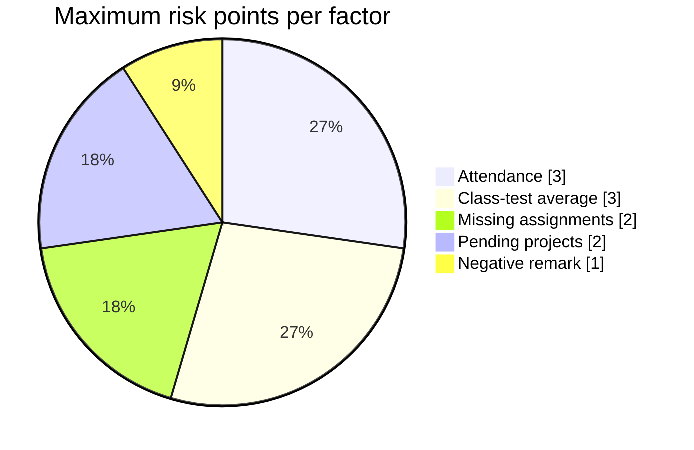

### Risk level logic

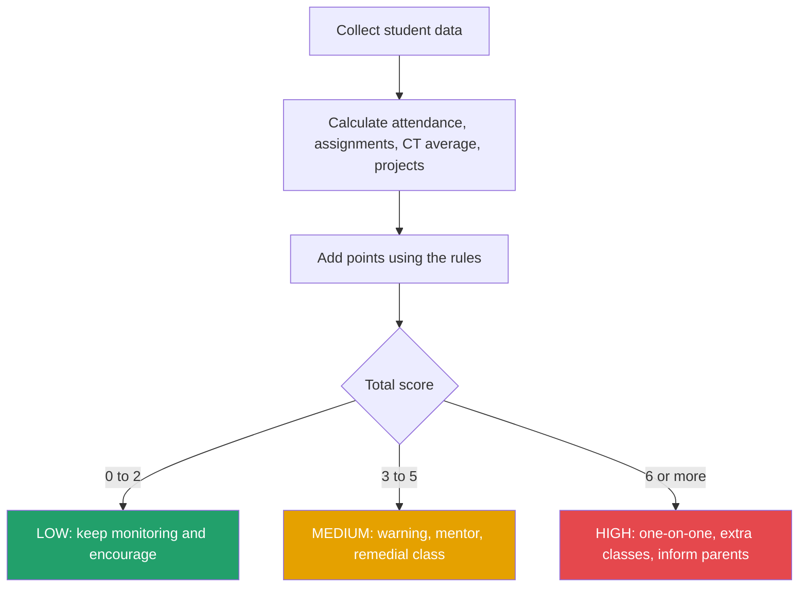

### Worked example

**Student: Riya**

| Factor | Her data | Points |
|---|---|---|
| Attendance | 68% | +2 |
| Missing assignments | 2 | +1 |
| Class-test average | 52% | +1 |
| Pending projects | 1 | +1 |
| Latest remark | negative | +1 |
| **Total** | | **6 = HIGH** |

**What KavachED shows:**
- Reasons: *"Attendance 68%, below the 75% limit"*, *"2 assignments missing"*, *"Class-test average 52%"*, *"1 project pending"*
- Weakest subject: the subject with the lowest combined performance
- Suggested action: one-on-one meeting, extra classes, inform parents
- Trend: Improving, Stable or Declining, based on the last 8 weeks of `risk_history`

---

## Leave Calculator and What-If

This is **pure maths**, not AI.

```text
classes you can still miss = max(0, floor(attended / 0.75 - held))
```

**Example:** attended 30, held 38 gives `30 / 0.75 = 40`, and `40 - 38 = 2`.
So you can miss **2 more classes** and still stay at 75%.

If you are already below the limit, KavachED calculates how many **consecutive classes** you must attend to recover.

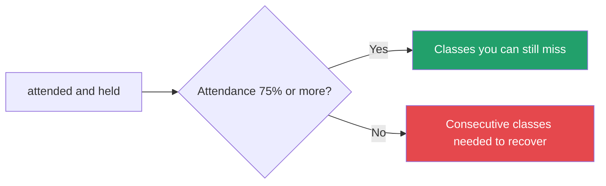

**What-If:** drag a slider ("attend next 10 classes", "score 70% in next CT") and see attendance and risk **before vs after** on gauge charts.

---

## How RAG Works

**RAG** means *Retrieval-Augmented Generation*. In simple words: **the AI answers only from your own documents and data, so it cannot make things up.**

### 4 simple steps

1. **Split** each document into small chunks (about 500 characters, 100 overlap).
2. **Match** your question against the chunks using TF-IDF.
3. **Send** the top 3 chunks to Groq along with your own data summary.
4. **Show** the answer with source chips (document name + chunk number).

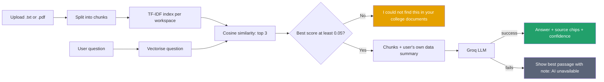

### Safety rules for the AI

| Rule | Why |
|---|---|
| Use only the provided data and context | Stops made-up answers |
| Never invent numbers | Numbers come from the database or leave maths |
| If not found, say so | Honest answers build trust |
| Cite document names | Everything can be checked |
| Weak match (below 0.05) skips the AI | No call is made when there is nothing to ground it |
| Students see only their own data | Privacy by design |

---

## Database Design

Every table except `users` has a **`workspace_id`**, and **every query filters by it**. This is how each teacher gets a private space.

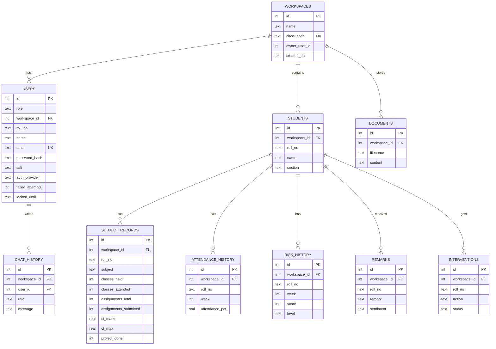

### Access rules

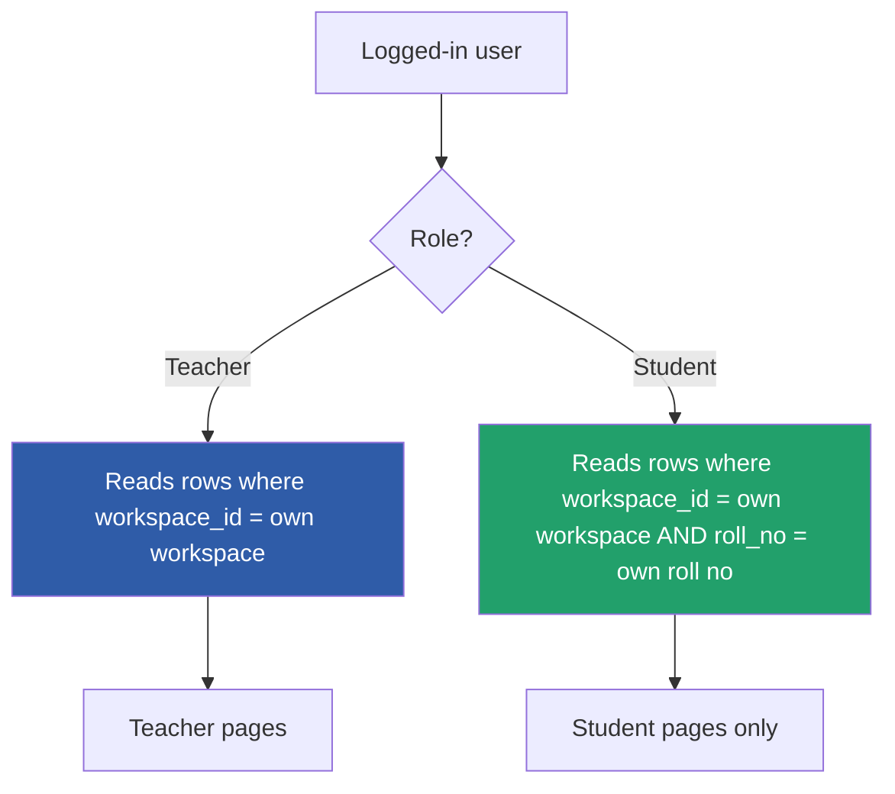

---

## Tech Stack

| Tool | What it does | Why we picked it |
|---|---|---|
| **Python 3.10+** | Language everything is written in | Easy to learn, great for data and AI |
| **Streamlit** | Turns Python into a web app | No separate front-end team needed, free deployment |
| **SQLite** | Stores all records in one file | No server to set up or pay for |
| **pandas** | Handles tables and CSV uploads | Fast way to clean and count data |
| **Plotly** | Charts and gauges | Interactive and works in light and dark |
| **scikit-learn** | TF-IDF document search | Light and free, no heavy AI model needed |
| **pypdf** | Reads text from PDFs | So college rules can be searched |
| **Groq API** | The AI that writes answers and plans | Very fast, with a free tier |
| **Authlib** | Google sign-in via `st.login` | Standard and secure OAuth |
| **Pillow** | Generates the favicon | Simple image handling |
| **pytest** | Automated tests | Proves the risk and auth logic works |

**Deliberately not used:** LangChain, FAISS, torch, sentence-transformers, chromadb and bcrypt. They are heavy for this scale and add deployment risk.

### Design trade-offs

| Choice | Benefit | Trade-off |
|---|---|---|
| Rule-based risk | Fully explainable and trustworthy | Rules are fixed, not learned |
| TF-IDF search | Light, fast, easy to explain | Matches words, not meaning |
| SQLite | Zero setup | Limited concurrent writes |
| Streamlit | Very fast to build | Less control over UI than a custom front-end |

---

## Quick Start

```bash
# 1. Clone
git clone https://github.com/<your-username>/kavached.git
cd kavached

# 2. (Optional) create a virtual environment
python -m venv .venv
source .venv/bin/activate        # Windows: .venv\Scripts\activate

# 3. Install
pip install -r requirements.txt

# 4. Run
streamlit run app.py
```

Open **http://localhost:8501**. The demo workspace is created automatically on first start.

---

## Demo Credentials

| Role | Email | Password |
|---|---|---|
| Teacher | `teacher.demo@kavached.app` | `KavachDemo@26` |
| Student | `student.demo@kavached.app` | `KavachDemo@26` |

**Demo class code:** `KVCH-DEMO`

The demo workspace ("KavachED Demo College") has 30 students across sections A and B, 5 subjects, 8 weeks of history, remarks, interventions in all three statuses and two policy documents. The demo student is linked to roll number `CS21014`.

> All demo data is synthetic. No real student information is used.

**Try a fresh account:** sign up as a new teacher to see the empty-state onboarding, then sign up as a student with the new class code.

---

## Configuration

### Groq API key (for AI answers)

1. Create a free key at [console.groq.com](https://console.groq.com).
2. Copy `.streamlit/secrets.toml.example` to `.streamlit/secrets.toml` and add:

```toml
GROQ_API_KEY = "your-key-here"
```

3. Optional: choose a model with an environment variable (default `llama-3.3-70b-versatile`):

```bash
export GROQ_MODEL="llama-3.3-70b-versatile"
```

**No key?** The app still works. KavachBot switches to rule-based mode and shows *"AI unavailable, showing the best matching passage"*.

### Google sign-in (optional)

1. Open [Google Cloud Console](https://console.cloud.google.com), create a project, then go to **APIs and Services > Credentials**.
2. Create an **OAuth client ID** (type: Web application).
3. Add redirect URI: `http://localhost:8501/oauth2callback` (and your deployed URL + `/oauth2callback`).
4. Add this to `.streamlit/secrets.toml`:

```toml
[auth]
redirect_uri = "http://localhost:8501/oauth2callback"
cookie_secret = "a-long-random-string"

[auth.google]
client_id = "your-client-id"
client_secret = "your-client-secret"
server_metadata_url = "https://accounts.google.com/.well-known/openid-configuration"
```

5. Restart the app. After the first Google login, the user completes a short profile (role, class code, roll number).

Without this setup, the Google button is shown disabled with a tooltip.

---

## Deployment

### Streamlit Community Cloud

1. Push the repository to GitHub.
2. Go to [share.streamlit.io](https://share.streamlit.io) and click **New app**.
3. Choose the repo, branch `main` and file `app.py`.
4. Under **Advanced settings > Secrets**, paste your `GROQ_API_KEY` (and the `[auth]` block if using Google).
5. Click **Deploy**.

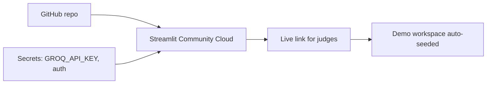

> **Note:** Community Cloud storage can reset when the app restarts. The demo workspace is re-created automatically, but new data you add may be lost. Use **Export all data** in Data Studio to keep backups.

---

## Project Structure

```text
kavached/
├── app.py                      # Entry: page config, theme, auth gate, router
├── core/
│   ├── auth.py                 # Sign up, login, hashing, lockout, Google
│   ├── db.py                   # Schema, workspace-scoped queries, demo seed
│   ├── risk.py                 # Risk engine, leave calculator, what-if, trend
│   ├── ai.py                   # Groq calls, study coach, KavachBot, fallbacks
│   ├── rag.py                  # Chunking, TF-IDF retrieval, grounded answers
│   └── charts.py               # Plotly helpers with light/dark templates
├── ui/
│   ├── theme.py                # Design tokens, CSS, 3D background
│   └── components.py           # Top bar, sidebar, KPI cards, badges, chat panel
├── views/
│   ├── landing.py              # Hero and auth card
│   ├── teacher_*.py            # One file per teacher page
│   ├── student_*.py            # One file per student page
│   └── shared_*.py             # Ask KavachED, Settings
├── assets/                     # Logos and favicon
├── docs/
│   ├── attendance_policy.txt
│   ├── exam_rules.txt
│   ├── ARCHITECTURE.md
│   └── USER_GUIDE.md
├── tests/
│   ├── test_risk.py
│   ├── test_rag.py
│   └── test_auth.py
├── .streamlit/
│   ├── config.toml
│   └── secrets.toml.example
├── .github/                    # Issue and PR templates
├── requirements.txt
├── README.md · CONTRIBUTING.md · CODE_OF_CONDUCT.md
├── SECURITY.md · CHANGELOG.md · LICENSE
└── .gitignore
```

---

## Testing

```bash
pytest -v
```

| Test file | What it checks |
|---|---|
| `tests/test_risk.py` | Risk levels, score boundaries, leave calculator, what-if |
| `tests/test_rag.py` | Chunk size and overlap, retrieval, "not found" threshold |
| `tests/test_auth.py` | Password hashing, wrong-password lockout, email validation |

**Manual QA checklist**

- [ ] Fresh teacher signup shows empty onboarding
- [ ] Adding a student and a record updates the dashboards
- [ ] Fresh student signup with a class code shows the linked empty state
- [ ] Demo teacher and demo student show fully populated products
- [ ] 5 wrong passwords lock the account for 5 minutes
- [ ] A student cannot open teacher pages or see another student's data
- [ ] Every page works in light and dark mode
- [ ] App works with and without `GROQ_API_KEY`

---

## Security

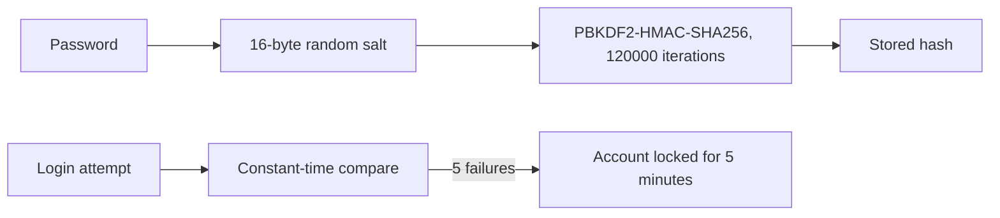

| Measure | How it is done |
|---|---|
| Password storage | PBKDF2-HMAC-SHA256, per-user salt, constant-time comparison |
| Brute force | Lock after 5 failed attempts for 5 minutes; generic "Invalid email or password" |
| SQL injection | Parameterized queries only |
| XSS | Every user-supplied string is HTML-escaped before rendering |
| Data isolation | `workspace_id` filter on every query, taken from the server-side session |
| Student privacy | Students can read only rows matching their own roll number |
| Secrets | API keys only in `st.secrets` or environment variables, never in code |
| AI safety | Context-only prompts and a retrieval threshold |

**For production we would add:** higher PBKDF2 iterations, email verification, HTTPS-only hosting, audit logs and compliance with India's DPDP Act 2023 (consent, data minimisation, retention).

See [SECURITY.md](SECURITY.md) to report a vulnerability privately.

---

## Limitations (Honest List)

| Limitation | Plan |
|---|---|
| Risk rules are fixed (75% limit, set weights) | Configurable rules per college |
| Rule-based risk, not ML | Optional ML to support, never replace, explanations |
| TF-IDF matches words, not meaning | Embedding-based search |
| SQLite has limited concurrency and may reset on free cloud hosting | PostgreSQL |
| No ERP integration | ERP connectors |
| No email or SMS alerts yet | Notifications to students and parents |
| Demo data is synthetic | Pilot with a real college |
| Impact on dropouts not yet measured | Measure in a pilot |

---

## Roadmap

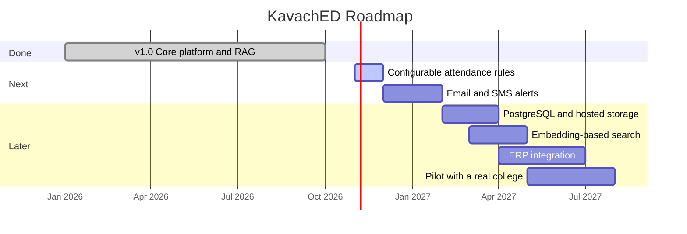

---

## FAQ

**Is the risk score made by AI?**
No. The risk score uses clear rules, so every flag can be explained. AI is used for the study coach, KavachBot and document answers.

**Can the AI make things up?**
It is told to use only your data and documents, never to invent numbers, and to say "I could not find this" when unsure. Weak matches never reach the AI at all.

**Will I see other colleges' data?**
Never. Each teacher has a private workspace and every query is filtered by it.

**Can a student see other students' data?**
No. Student accounts can read only their own roll number and cannot open teacher pages.

**What if there is no internet or the AI key is missing?**
The app keeps working in rule-based mode. Risk, leave maths and dashboards do not need the AI.

**Is my 75% limit the same as my college's?**
Colleges differ. 75% is the default; configurable limits are on the roadmap.

**Does KavachED replace teachers?**
No. It supports teachers' decisions. Humans decide the action.

**Is the sample data real?**
No. All sample data is synthetic.

---

## Team

Four students from Lucknow, one shared idea.

| Member | Role | Institute |
|---|---|---|
| **Mahek Bajpai** | Backend, AI and architecture | BIET, Lucknow |
| **Drishti Dixit** | Frontend and UI design | BBDU, Lucknow |
| **Drishti Kandpal** | UI/UX support, content and data preparation | MUIT, Lucknow |
| **Aditi Pandey** | UI testing, research and presentation | MUIT, Lucknow |

---

## Documentation

- [Architecture](docs/ARCHITECTURE.md)
- [User Guide](docs/USER_GUIDE.md)
- [Contributing](CONTRIBUTING.md)
- [Code of Conduct](CODE_OF_CONDUCT.md)
- [Security Policy](SECURITY.md)
- [Changelog](CHANGELOG.md)

---

## Acknowledgements

- **AISHE 2021-22**, Ministry of Education, Government of India, for higher-education enrolment statistics.
- **Streamlit**, **Plotly**, **scikit-learn**, **pandas**, **pypdf** and **Groq** for the tools that made this possible.
- Supports **UN Sustainable Development Goal 4: Quality Education**.

---

<div align="center">

### Every student deserves a shield before the exam, not after.

**Spot risk early. Act in time.**

Released under the [MIT License](LICENSE).

</div>
