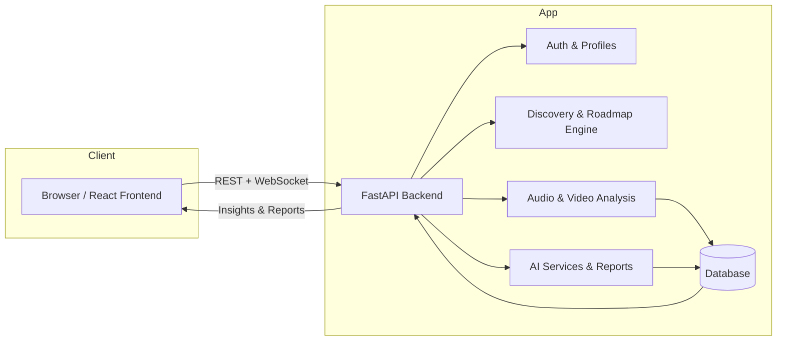
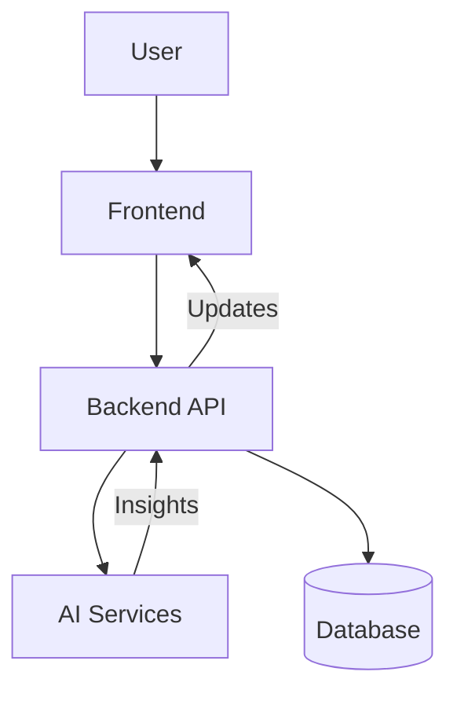
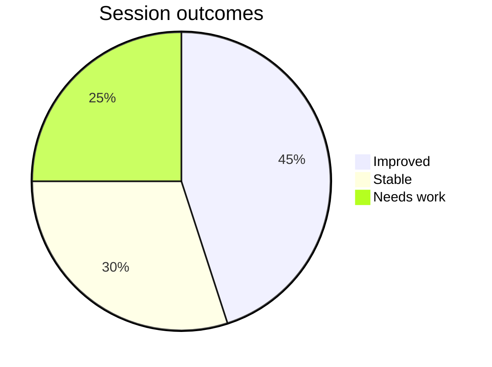
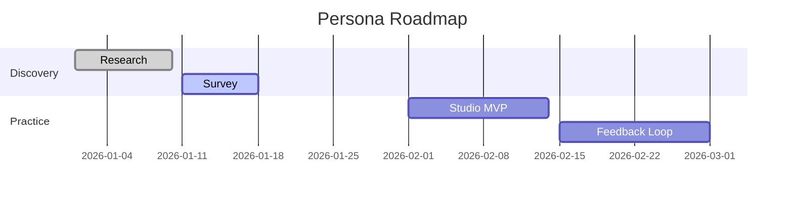
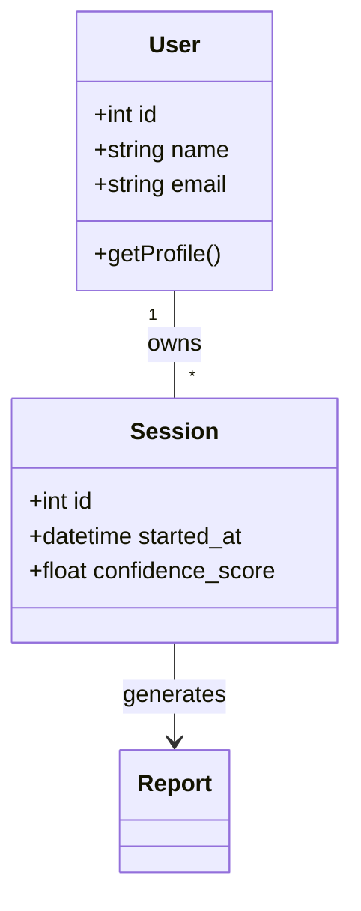
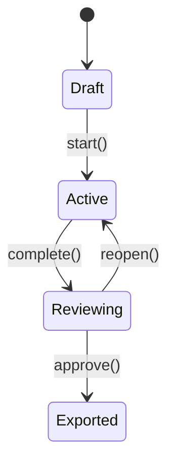

# Persona Prime

[](https://github.com/logiclayer0/PERSONA_PRIME/releases)
[](https://github.com/logiclayer0/PERSONA_PRIME/actions)
[](https://github.com/logiclayer0/PERSONA_PRIME/issues)
[](https://github.com/logiclayer0/PERSONA_PRIME/pulls)
[](LICENSE)
[](https://github.com/logiclayer0/PERSONA_PRIME)

AI-assisted personal development and communication coaching for students and early-career professionals — helping users uncover strengths, sharpen communication habits, and turn reflection into measurable progress.

<p align="center">
  <a href="https://persona-prime.vercel.app"><strong>Live App</strong></a>
  ·
  <a href="https://github.com/logiclayer0/PERSONA_PRIME/issues">Report an Issue</a>
  ·
  <a href="https://github.com/logiclayer0/PERSONA_PRIME/pulls">Contribute</a>
</p>

> [!NOTE]
> Persona Prime blends self-discovery, AI guidance, communication practice, and progress tracking into a single workflow designed to support meaningful growth without replacing professional advice.

> [!WARNING]
> AI-generated insights are supportive guidance, not clinical assessment. Users should interpret them as coaching signals rather than definitive psychological diagnoses.

---

## Overview

Persona Prime helps learners and early-career professionals:

- understand their strengths, preferences, and development areas
- build a personalized roadmap based on reflection and self-assessment
- practice communication with guided video and audio analysis
- track progress and export reports for tangible next steps

The platform combines reflection, AI-assisted analysis, coaching prompts, and structured feedback into one experience.

---

## Problem

Many learners do not need more generic advice — they need structured self-understanding, targeted feedback, and repeated practice. Without intentional reflection and guided coaching, growth efforts stagnate.

---

## Solution

Persona Prime turns self-awareness into a practical system:

- discovery-based profile generation
- personalized development roadmap
- guided communication practice
- session analysis with actionable feedback
- exportable progress reports

---

## Feature Architecture



This architecture separates the product experience into a polished React frontend and a Python/FastAPI backend responsible for data flow, analysis, and AI-generated recommendations.

---

## Diagrams & Charts

To present system design, progress metrics, and timelines professionally in the README and documentation, Persona Prime uses a combination of lightweight diagram types that render well on GitHub and in developer tooling.

Below are recommended diagram formats, concise examples (Mermaid), and practical notes for producing high-quality visuals for docs and reports.

### Flowcharts
- Purpose: Visualize component interactions, request/response flow, and high-level user paths.
- Recommended: Mermaid `flowchart` for simple architecture diagrams; export to PNG/SVG for inclusion in other docs when needed.



Notes:
- Keep nodes and labels short; annotate edges where necessary.
- For complex flows break diagrams into focused slices (authentication flow, session flow, report generation) to stay readable.

### Pie charts (Metrics)
- Purpose: Show distribution (e.g., session types, confidence buckets, category breakdowns).
- Recommended: Use Mermaid `pie` for quick inline visuals. For interactive or production-quality charts (tooltips, legends) use Chart.js or D3 in the frontend.

Mermaid example:



Chart.js (frontend) example snippet:

```js
import { Pie } from 'react-chartjs-2'

const data = {
  labels: ['Improved','Stable','Needs work'],
  datasets: [{ data: [45,30,25], backgroundColor: ['#4caf50','#ffca28','#f44336'] }]
}

<Pie data={data} />
```

### Gantt charts (Roadmaps & Timelines)
- Purpose: Visualize user roadmaps, milestones, and multi-step plans over time.
- Recommended: Mermaid `gantt` for README timelines; for richer features consider Grafana/Plotly or exporting from a PM tool.



Notes:
- Use concise task names and align dates to meaningful milestones.
- For multi-user planning export Gantt to shared tooling (Asana, Trello Power-Ups, or CSV imports) for richer collaboration.

### Class diagrams (Design & Models)
- Purpose: Communicate domain models and key relationships (e.g., User, Session, Report, Blueprint).
- Recommended: Mermaid `classDiagram` for compact model summaries.



Notes:
- Keep attributes and methods minimal in README diagrams; link to full schema files in the repo for details.

### State diagrams
- Purpose: Describe lifecycle of entities (e.g., session state transitions: draft → active → reviewed → exported).
- Recommended: Mermaid `stateDiagram` for readable lifecycle diagrams.



Notes:
- Use explicit transition labels for actions/guards.
- Model error/retry paths where media processing or model inference may fail.

### Exporting, Rendering, and Accessibility
- GitHub renders Mermaid blocks in Markdown; if you need images for other audiences, export diagrams to SVG or PNG using tools like mermaid-cli, Kroki, or the Mermaid Live Editor.
- For charts embedded in the app, prefer frontend libraries (Chart.js, D3, Plotly) for interactivity and accessibility (keyboard/ARIA support).
- Keep alt text or adjacent captions for exported images to improve accessibility.

---

## User Journey Flow

```mermaid
sequenceDiagram
    participant U as User
    participant F as Frontend
    participant B as Backend
    participant A as Analysis / AI Services
    participant D as Database

    U->>F: Sign in and complete discovery survey
    F->>B: Submit responses and profile data
    B->>A: Generate personal profile and roadmap
    A-->>B: Insights, strengths, and area for growth
    B->>D: Save profile and blueprint
    D-->>F: Return personalized roadmap

    U->>F: Enter communication practice studio
    F->>B: Start session and open media streams
    loop During practice
      F->>B: Send audio/video frames
      B->>A: Analyze posture, speech, cues, and delivery
      A-->>B: Partial observations and signals
      B-->>F: Live progress and interim feedback
    end
    B->>A: Finalize report
    A-->>B: Feedback summary
    B->>D: Save session results
    B->>>F: Final report and PDF export
    F->>>U: Display guidance and roadmap updates
```

---

## Core Features

### 1. Discover Yourself
- guided reflections on preferences, habits, strengths, and development goals
- resume-friendly profile generation
- personalized roadmaps based on user input

### 2. Personal Development Blueprint
- AI-assisted roadmap generation
- summary of strengths, confidence areas, and growth opportunities
- saved blueprint export in PDF format

### 3. Communication Practice Studio
- guided role and category-based preparation
- script selection and rehearsal setup
- speech and video analysis for delivery quality

### 4. Feedback and Reports
- combination of speaking and visual cues into a structured assessment
- practical feedback loops for communication improvement
- recommendations based on actual session outcomes

### 5. Progress and Settings
- session tracking and progress monitoring
- profile, preference, and theme management
- authentication-protected access

### 6. Persona Experience
- interactive coaching-oriented interface design
- immersive user experience focused on confidence and growth

---

## Technology Stack

| Area | Technologies |
|---|---|
| Frontend | React 18, Vite, React Router |
| UI & Interaction | CSS, Framer Motion |
| State & Requests | Zustand, Axios |
| 3D / Avatar Support | Three.js, React Three Fiber, Drei |
| Backend API | Python, FastAPI, Uvicorn |
| Data Validation | Pydantic, pydantic-settings |
| Persistence | SQLAlchemy, SQLite by default |
| Authentication | JWT via python-jose, Passlib/Bcrypt |
| Video / Vision | MediaPipe, OpenCV, NumPy |
| Speech Analysis | OpenAI Whisper, PyDub, FFmpeg |
| AI Roadmap Generation | Groq API |
| PDF Export | ReportLab |
| Deployment | Vercel frontend; Render-compatible backend |

---

## Architecture Overview

```text
Persona Prime
├── frontend/                 React + Vite frontend
│   └── src/
│       ├── pages/            landing, auth, dashboard, discovery,
│       │                     blueprint, studio, reports, progress, settings
│       ├── components/       shared UI and avatar components
│       ├── services/         API layer
│       ├── context/          providers and theme state
│       └── store/            client-side state
│
├── backend/                  FastAPI service
│   └── app/
│       ├── api/              auth, discovery, audio, video, analytics
│       ├── core/              analysis utilities
│       ├── models/            SQLAlchemy models
│       ├── schemas/           request/response validation
│       ├── data/              discovery content
│       └── services/          roadmap and AI services
│
├── docker-compose.yml
├── LICENSE
├── README.md
├── .gitignore
└── package.json
```

---

## Getting Started

### Prerequisites

- Git
- Node.js 18+
- Python 3.11+
- FFmpeg for audio processing
- Groq API key for roadmap generation

### 1. Clone the repository

```bash
git clone https://github.com/logiclayer0/PERSONA_PRIME.git
cd PERSONA_PRIME
```

### 2. Configure the backend

Create and activate a virtual environment:

<details>
<summary>Windows (PowerShell)</summary>

```powershell
py -3.11 -m venv .venv
.\.venv\Scripts\Activate.ps1
pip install -r backend/requirements.txt
```

</details>

<details>
<summary>macOS / Linux</summary>

```bash
python3.11 -m venv .venv
source .venv/bin/activate
pip install -r backend/requirements.txt
```

</details>

Create `backend/.env` with:

```dotenv
GROQ_API_KEY=your_groq_api_key
SECRET_KEY=replace_with_a_long_random_secret
ALGORITHM=HS256
ACCESS_TOKEN_EXPIRE_MINUTES=1440
DATABASE_URL=sqlite:///./persona_prime.db
FRONTEND_ORIGINS=http://localhost:5173,http://127.0.0.1:5173,https://persona-prime.vercel.app
```

Then start the API:

```bash
cd backend
uvicorn app.main:app --reload --host 127.0.0.1 --port 8000
```

The API docs will be available at:

- Swagger UI: http://127.0.0.1:8000/docs
- OpenAPI schema: http://127.0.0.1:8000/openapi.json

### 3. Configure and run the frontend

From a second terminal:

```bash
cd frontend
npm install
npm run dev
```

The application is typically available at http://localhost:5173.

### 4. Run with Docker (optional)

```bash
docker compose up --build
```

---

## API Overview

The FastAPI service organizes functionality into route areas:

| Area | Purpose |
|---|---|
| `/auth` | registration, login, profile, preferences |
| `/discovery` | discovery questions, roadmap generation, PDF export |
| `/audio` | uploaded-audio analysis |
| `/video/analyze` | WebSocket-based video analysis |
| analytics & script routes | communication-practice support workflows |

For full schemas and examples, use the running Swagger UI at `/docs`.

---

## Security and Configuration

- keep `.env` and credentials out of version control
- use a strong production secret for `SECRET_KEY`
- restrict `FRONTEND_ORIGINS` to trusted domains
- use HTTPS in deployment
- treat AI-generated prompts and insights as supportive guidance, not final judgment

> [!NOTE]
> For production deployments, validate all environment variables before launching the service stack.

---

## Algorithms & Math

For algorithmic or cryptographic concepts, Persona Prime documentation can include formal mathematical expressions directly in the README.

### Example: Communication confidence model

A simple confidence score can be represented as:

$$
C = \alpha S + \beta P + \gamma R - \delta F
$$

where:

- $C$ = confidence score
- $S$ = strength signal
- $P$ = practice consistency
- $R$ = reflection quality
- $F$ = friction or uncertainty penalty
- $\alpha, \beta, \gamma, \delta$ = weighting factors

This allows a lightweight model to represent how repeated practice and reflection can compound growth.

### Example: Hash collision estimate

For a hash function with output size $k$ bits, the collision probability after $t$ samples is approximately:

$$
P_{coll} \approx 1 - e^{-\frac{t(t-1)}{2\cdot 2^k}}
$$

This kind of equation is useful in systems where security, uniqueness, or verification quality matters.

---

## CLI and Keyboard Shortcuts

For developer workflows and local tool usage, keyboard controls can be shown clearly with `<kbd>` tags:

- <kbd>Ctrl</kbd> + <kbd>C</kbd> to stop a running process
- <kbd>Ctrl</kbd> + <kbd>L</kbd> to clear the terminal
- <kbd>Tab</kbd> to move through interactive prompts or UI controls

---

## Sample Logs

<details>
<summary>View sample server logs</summary>

```log
[INFO] 2026-10-14T10:00:00Z Server started on port 8000
[INFO] 2026-10-14T10:01:02Z POST /v1/send 200 OK
[WARNING] 2026-10-14T10:02:12Z Low audio clarity detected during session analysis
[ERROR] 2026-10-14T10:03:40Z AI service timeout during roadmap generation
```

</details>

---

## Development Priorities

- add automated tests for auth, discovery, and analysis endpoints
- improve observability and resilience for AI/media-processing failures
- simplify deployment configuration for production environments
- continue UX and accessibility improvements

---

## Contributing

Contributions are welcome. Before submitting changes:

1. explain the issue or improvement clearly
2. keep changes focused and avoid committing secrets or generated data
3. test the affected frontend or backend workflow
4. include reproduction steps for bugs

Use the repository's Issues page to report bugs or propose enhancements.

---

## License

This project is distributed under the MIT License. See [LICENSE](LICENSE) for details.

---

## Links

- Live application: https://persona-prime.vercel.app
- Source code: https://github.com/logiclayer0/PERSONA_PRIME
- Issues: https://github.com/logiclayer0/PERSONA_PRIME/issues
- Pull requests: https://github.com/logiclayer0/PERSONA_PRIME/pulls

---

<p align="center"><strong>Persona Prime — Discover your strengths. Practice with purpose. Grow with a plan.</strong></p>
